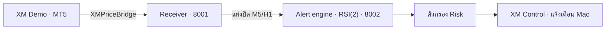

# XAUUSD Signal Desk · XM Control

ระบบรับราคาทองจาก **XM Demo ผ่าน MT5 บน Mac** แล้ว**แจ้งเตือนจังหวะเข้า trade** ตามกลยุทธ์ **RSI(2) trend pullback** ผ่านแอป **XM Control** และการแจ้งเตือนของ macOS

ตั้งแต่ 8 พฤศจิกายน 2026 โหมดที่เปิดใช้คือ **แจ้งเตือนอย่างเดียว (`alert_only`)**:

- ไม่เรียก AI (LM Studio/Codex)
- ไม่ใช้บัญชี Paper
- ไม่ส่งคำสั่งซื้อขายไป MT5
- ผู้ใช้ตัดสินใจและส่งคำสั่งเองใน MT5

โค้ดและฐานข้อมูลของโหมด AI/Paper เดิมยังอยู่ แต่บริการไม่ได้เปิดใช้ ([ALERTS.md](ALERTS.md#โหมด-aipaper-เดิม))



## เริ่มใช้งานประจำวันบน Mac

สำหรับเครื่องที่ตั้งค่า MT5, EA และ Python ไว้แล้ว:

1. เปิด **MT5** และเชื่อมบัญชี Demo บน `XMGlobal-MT5 7` ตรวจว่ามี EA `XMPriceBridge` บนกราฟ (`GoldSymbol=GOLD`) ตั้ง input `HistoryBars=1000` เพื่อให้กลยุทธ์พร้อมแจ้งเตือนทันทีหลังเริ่ม (ดู [ALERTS.md](ALERTS.md#การอุ่นเครื่อง-indicator)) ส่วน `XMPaperTicks` ไม่จำเป็นในโหมดนี้
2. เปิด [XM Control.app](<mac/build/XM Control.app>) จาก Finder แล้วกด **เริ่มบริการ** แอปเปิดบริการ Python ที่พอร์ต 8001 และ 8002; หากรันอยู่แล้วจะใช้ตัวเดิม
3. รอให้แถบสถานะขึ้น **พร้อมแจ้งเตือนจังหวะเข้า trade** หมายถึงราคาจาก MT5 สด, engine อุ่นเครื่อง indicator ครบ และ worker ทำงาน

เปิดการแจ้งเตือนจากปุ่มในแอป และอนุญาต **System Settings → Notifications → XM Control** กดทดสอบเพื่อยืนยันการส่งได้

เมื่อมีสัญญาณ แอปแจ้งเตือนข้อมูลต่อไปนี้ ([รายละเอียด](ALERTS.md#อ่านการแจ้งเตือน)):

- ฝั่ง BUY/SELL พร้อมราคาอ้างอิง, SL, TP และ RR สุทธิ
- เวลาที่ยังเข้าได้ (5 นาทีหลังแท่งปิด) และราคาที่ยังรับได้
- เวลาที่ควรปิดถ้ายังไม่ถึง SL/TP (4 ชั่วโมง)

Mac ต้องเปิด MT5 และบริการ Python ต่อเนื่อง ขณะรับการแจ้งเตือนต้องเปิด XM Control ค้างไว้ด้วย:

- ปิดหน้าต่างแล้ว แอปยังอยู่ในแถบเมนู **◈ XM**
- ออกจากแอปจะหยุดการแจ้งเตือน แต่บริการ Python ยังทำงานต่อ
- ยังไม่ได้ตั้งให้เปิดอัตโนมัติพร้อมล็อกอิน Mac

### ปุ่มควบคุม

| ปุ่ม | ผล |
| --- | --- |
| เริ่มบริการ | เปิด receiver และบริการแจ้งเตือนในเครื่อง ไม่เปิด MT5 แทนผู้ใช้ |
| ปิดเสียงแจ้งเตือน | ยังคำนวณและบันทึกสัญญาณต่อ แต่ไม่ส่งการแจ้งเตือน (จดจำค่าข้ามการเริ่มใหม่) |
| เปิดเสียงแจ้งเตือน | กลับมาแจ้งเตือนสัญญาณใหม่ |
| หยุดบริการ | หยุด receiver และบริการแจ้งเตือน จะไม่มีการแจ้งเตือนจนกว่าจะเริ่มใหม่ |

รายละเอียดหน้าจออยู่ใน [MAC-CONTROL.md](MAC-CONTROL.md)

## รันผ่าน Terminal

รันคำสั่งจากโฟลเดอร์ `xauusd-ai-agent` ใช้ Terminal สองหน้าต่าง หรือใช้ปุ่มเริ่มบริการในแอป:

**Terminal 1 — รับข้อมูลจาก MT5**

```sh
sh scripts/run_mt5_bridge.sh
```

**Terminal 2 — กลยุทธ์และการแจ้งเตือน**

```sh
sh scripts/run_xm.sh
```

ตรวจสถานะจากอีก Terminal โดยสคริปต์อ่าน token ภายในเครื่องให้:

```sh
.venv/bin/python scripts/mt5_status.py GOLD
.venv/bin/python scripts/xm_status.py
```

เมื่อเปิดผ่านแอป log อยู่ที่ `.runtime/receiver.log` และ `.runtime/xm.log` หากรันใน Terminal จะเห็นสถานะ `ALERT engine status=...` ในหน้าต่างนั้น

| บริการ | ที่อยู่ในเครื่อง | ฐานข้อมูล |
| --- | --- | --- |
| MT5 receiver: snapshots และ ticks | `127.0.0.1:8001` | `data/mt5-market.db` |
| Alert engine, ตัวกรอง Risk และ Control API | `127.0.0.1:8002` | `data/xm-alerts.db` |
| TradingView/OANDA webhook ทางเลือก | `127.0.0.1:8000` | `data/trading.db` |

ทุกบริการฟังเฉพาะ loopback และใช้ Uvicorn หนึ่ง worker ตรวจ `/health` ได้โดยไม่ใช้ token แต่ผลนี้ยืนยันแค่ตัวบริการ ฐานข้อมูล และ worker **ไม่ได้ยืนยันว่าได้ราคาใหม่** ให้ดูหน้าจอและคำสั่งสถานะประกอบ

## ติดตั้งบนเครื่องใหม่

ต้องมี Python 3.11, MT5 สำหรับ Mac และบัญชี XM Demo หากจะ build แอป Mac ต้องมี Xcode Command Line Tools และ macOS 13 ขึ้นไป

```sh
python3.11 -m venv .venv
.venv/bin/python -m pip install -r requirements-lock.txt
.venv/bin/python scripts/init_env.py
.venv/bin/python scripts/init_mt5.py
```

`init_env.py` สร้าง `.env` พร้อม token แยกสำหรับรับ/อ่านสัญญาณ ส่วน `init_mt5.py` สร้าง `.env.mt5` และ `mt5/bridge-token.txt` ทั้งสองสคริปต์ไม่เขียนทับค่าที่มีอยู่ ไฟล์ลับใช้สิทธิ์ 0600 และถูกละเว้นใน Git ดูตัวแปรตัวอย่างใน [.env.example](.env.example)

จากนั้นตั้งค่า MT5 ตาม [MT5.md](MT5.md):

1. ใน MT5 เลือก **File → Open Data Folder** คัดลอก source/binary ของ `XMPriceBridge` ไป `MQL5/Experts/` ถ้าคอมไพล์ใหม่ให้ตรวจว่าไม่มี errors (`XMPaperTicks` ใช้เฉพาะโหมด Paper เดิม)
2. คัดลอก `mt5/bridge-token.txt` ไป `MQL5/Files/`
3. ที่ **Tools → Options → Expert Advisors** อนุญาต WebRequest ไป `http://127.0.0.1:8001`
4. แนบ `XMPriceBridge` บนกราฟ โดยใช้ server และ symbol ตรงกับบัญชีที่ตั้งค่าไว้ ตั้ง `HistoryBars=1000` แล้วรอประวัติ M5/H1 ครบ
5. ปิดตัวแอปก่อน build:

```sh
sh scripts/build_mac.sh
```

เปิด `mac/build/XM Control.app` แล้วทำตามขั้นตอนใช้งานประจำวัน หากย้ายโฟลเดอร์โครงการ ให้ build ใหม่เพื่อบันทึกตำแหน่งที่ถูกต้อง

`requirements-lock.txt` ระบุเวอร์ชันที่ใช้ทดสอบ รวมเครื่องมือทดสอบ ส่วน `requirements.txt` และ `requirements-dev.txt` เป็นขอบเขต dependencies สำหรับการอัปเดต ค่าจาก environment มีลำดับเหนือ `.env` และ path แบบ relative อ้างอิงจากรากโครงการ

## กลยุทธ์และการแจ้งเตือน

กลยุทธ์ที่ใช้คือ `rsi2_trend_pullback_r2` ชุด **rr 2.5 ไม่มี breakeven, time stop 48 แท่ง** ซึ่งเป็นชุดที่ walk-forward 3 ปีเลือกบ่อยที่สุด ([ผลวิเคราะห์](tests/rsi2-live-gate-walkforward-2026-11-08.md)) ค่าทั้งหมดอยู่ใน [config/alert-xm.json](config/alert-xm.json)

| ขั้น | กติกา |
| --- | --- |
| แนวโน้ม H1 | BUY เมื่อราคาปิด H1 > EMA200 และ EMA50 > EMA200 · SELL กลับด้าน |
| ยืนยันบน M5 | BUY เมื่อราคาปิด M5 > EMA200 · SELL เมื่อต่ำกว่า |
| จังหวะเข้า | RSI(2) แท่งก่อน ≤ 5 แล้วแท่งนี้ปิดเหนือ high แท่งก่อน (SELL: ≥ 95 แล้วปิดใต้ low) |
| SL / TP | SL ห่าง 1.8 × ATR14 · TP ตั้งให้ RR สุทธิหลังหักต้นทุนเท่ากับ 2.5 |
| ออกตามเวลา | ถ้าไม่ถึง SL/TP ภายใน 48 แท่ง M5 (4 ชั่วโมง) |
| เวลาเข้า | 03:00–22:00 เวลา server ไม่เข้าวันศุกร์หลัง 20:00 |
| ตัวกรองต้นทุน | ข้ามสัญญาณที่ต้นทุนเกิน 8% ของระยะ SL (ทำงานเหมือนตัวกรองความผันผวน) |

หลังจากนั้นตรวจด้วยตัวกรอง Risk จาก [config/risk-xm-paper.json](config/risk-xm-paper.json) ชุดเดียวกับที่ใช้ใน backtest ได้แก่:

- RR สุทธิ ≥ 1.2
- ระยะ SL 1–3 ATR
- spread/ATR ≤ 0.20 โดยคิด spread อย่างน้อย 0.60
- อายุสัญญาณ ≤ 300 วินาที และต้องมาจาก server/symbol ที่ pin ไว้

สัญญาณที่ผ่านจะถูกบันทึกและแจ้งเตือน หลังสัญญาณหนึ่งจะไม่แจ้งสัญญาณใหม่จนกว่าไม้ตามกลยุทธ์ (สมมติว่าเข้าตามสัญญาณ) จะถึง SL, TP หรือครบเวลา เหมือนกฎหนึ่งไม้ต่อครั้งใน backtest

ผล backtest ไม่ใช่หลักฐานว่าจะทำกำไรได้จริง กำไรของกลยุทธ์นี้ในการทดสอบมาจากปีที่ใช้ออกแบบเป็นส่วนใหญ่ รายละเอียดการทำงาน การอุ่นเครื่อง และข้อจำกัดอยู่ใน [ALERTS.md](ALERTS.md)

## API สำหรับระบบแจ้งเตือน

บนพอร์ต **8002** ใช้ Bearer `API_TOKEN` สำหรับทุก endpoint ด้านล่าง ยกเว้น `/health`:

| Method / Path | หน้าที่ |
| --- | --- |
| GET `/health` | ตรวจบริการ/ฐานข้อมูล/engine worker |
| GET `/xm/status` | สถานะ alert engine, การอุ่นเครื่อง, indicator และไม้ตามกลยุทธ์ |
| GET `/alerts?after_id=0&limit=50` | สัญญาณที่บันทึก (`alert`, `missed`, `warmup`, `rejected`) พร้อมหลักฐาน |
| GET `/dashboard/state` | สถานะรวมสำหรับแอป: ราคา, engine, สัญญาณ, เหตุการณ์ และกติกา |
| POST `/dashboard/pause` | ปิด/เปิดเสียงแจ้งเตือนด้วย `{"paused":true}` หรือ `{"paused":false}` |

บนพอร์ต **8001** ใช้ Bearer `MT5_BRIDGE_TOKEN` จาก `.env.mt5`: `POST /mt5/snapshot`, `POST /mt5/ticks`, `GET /mt5/latest?symbol=GOLD`, `GET /mt5/ticks/cursor?symbol=GOLD` และ `GET /mt5/status` ส่วน `/health` ไม่ต้องใช้ token งบรับ snapshot คือ 20 คำขอ/นาที และ Tick 64 คำขอ/นาที แยกจากกัน

## ข้อมูลที่เก็บและความลับ

| ตำแหน่ง | เนื้อหา |
| --- | --- |
| `data/mt5-market.db` | Market snapshots, ordered ticks และ coverage/cursor |
| `data/xm-alerts.db` | Checkpoint ของกลยุทธ์, สัญญาณแจ้งเตือน, ประวัติการเริ่มคำนวณใหม่ และเหตุการณ์ UI |
| `data/xm-trading.db` | ข้อมูลโหมด AI/Paper เดิม (สัญญาณ, ผล AI/Risk, บัญชี Paper) ไม่ถูกเขียนในโหมดแจ้งเตือน |
| `data/trading.db` | สัญญาณจากเส้นทาง TradingView/OANDA ทางเลือก |
| `.runtime/` | Log ของบริการที่เริ่มผ่านแอป, รายงานตรวจ และฐานข้อมูลสำรองที่ทำไว้ |
| `config/` | Policy แจ้งเตือน (`alert-xm.json`), ตัวกรอง Risk และกฎบัญชี Paper เดิม |

`.env`, `.env.mt5`, ไฟล์ token, ฐานข้อมูล และ `.runtime/` ถูกละเว้นใน Git อย่าใส่ token ใน source, URL ที่แชร์, ภาพหน้าจอ หรือ log แอป Mac เก็บ bearer token ในฝั่ง native; หน้า UI ไม่มี token

สำรอง SQLite ด้วย backup API ขณะบริการทำงาน หรือหยุดบริการอย่างถูกต้องก่อนสำรอง เก็บฐานข้อมูลเดิมก่อนแก้ policy หรือสอบสวนปัญหาประวัติราคา

## แก้ปัญหาเบื้องต้น

| อาการ | ตรวจและดำเนินการ |
| --- | --- |
| ไม่พบข้อมูล MT5 | ตรวจ XM connection, server/symbol, EA, token ใน `MQL5/Files` และ WebRequest allowlist |
| `feed_stale` / ราคาไม่อัปเดต | ดู `XMPriceBridge` ใน Experts log และ `scripts/mt5_status.py GOLD` |
| กำลังอุ่นเครื่อง indicator นาน | EA ส่งประวัติน้อยเกินไป ตั้ง `HistoryBars=1000` ใน input ของ `XMPriceBridge` (ไม่ต้องคอมไพล์ใหม่) |
| เหตุการณ์ "เริ่มคำนวณกลยุทธ์ใหม่" | ข้อมูลขาดช่วงระหว่างที่บริการหยุด, แท่งที่ปิดแล้วถูกแก้ หรือแก้ policy; checkpoint เดิมเก็บไว้ใน `alert_engine_resets` แล้วต้องอุ่นเครื่องใหม่ |
| สัญญาณขึ้น "ไม่ผ่าน Risk" | ดูเหตุผลในประวัติสัญญาณ เช่น spread สูงเทียบ ATR หรือ RR สุทธิต่ำ |
| ไม่เห็นแจ้งเตือน Mac | ตรวจ Allow Notifications, Focus, ปุ่มปิดเสียง และให้แอปยังเปิดอยู่ |

หลังเปลี่ยนไฟล์ EA ให้นำตัวเดิมออกจากกราฟ → Navigator → Refresh → แนบใหม่ เพื่อโหลดโค้ดใหม่

## การทดสอบและผลตรวจล่าสุด

ทดสอบอัตโนมัติด้วยข้อมูลจำลองและฐานข้อมูลชั่วคราว:

```sh
.venv/bin/python -m pytest -q
.venv/bin/python scripts/smoke_test.py
.venv/bin/python scripts/smoke_mt5.py
```

ทดสอบ AI จริงโดยสมัครใจ ใช้ข้อมูลสมมติและฐานข้อมูลแยกจากบัญชีใช้งาน คำสั่ง Codex ใช้โควตาบัญชี:

```sh
.venv/bin/python scripts/test_lm_studio.py --xm --provider lm_studio
.venv/bin/python scripts/test_lm_studio.py --xm --provider codex
```

### Backtest ย้อนหลังแบบออฟไลน์

`backtest/` ทดสอบกลยุทธ์จากไฟล์ M1 ของโบรกเกอร์ (`data/history/xm_gold_m1.csv` จาก `mt5/XMExportHistory.mq5`) โดยไม่แตะ service, ฐานข้อมูล หรือบัญชี Paper ผลเขียนที่ `.runtime/backtest/<run>/summary.json` และ `trades.json`

สคริปต์ export ดึงย้อนหลัง `MonthsBack` เดือน (ค่าเริ่มต้น 36, สูงสุด 36) ข้อมูล M1 3 ปีมีประมาณ 1.06 ล้านแท่ง จึงต้องตั้ง MT5 **Tools → Options → Charts → Max bars in chart** ให้มากพอ (เช่น Unlimited) แล้วเปิด MT5 ใหม่ก่อน export ไฟล์ 3 ปีที่ใช้ทดสอบเก็บไว้เป็น `data/history/xm_gold_m1_36m.csv` และส่งเข้าเครื่องมือด้วย `--data`

```sh
.venv/bin/python scripts/run_backtest.py --strategy baseline_xm01
.venv/bin/python scripts/run_backtest.py --strategy baseline_xm01 --params '{"structure_filter": false, "exits": {"breakeven_r": 1}}'
.venv/bin/python scripts/run_backtest.py --write-synthetic /tmp/xm-synthetic.csv --synthetic-days 60
.venv/bin/python scripts/run_backtest.py --strategy baseline_xm01 --data /tmp/xm-synthetic.csv
```

- สัญญาณคำนวณบนแท่ง M5 ที่ปิดแล้วเท่านั้น เข้าที่ราคาเปิดแท่งถัดไป (BUY ที่ Ask, SELL ที่ Bid โดย Ask = Bid + `spread_points` × point) และตรวจ SL/TP บนเส้นทาง M1 ถ้าแท่ง M1 เดียวแตะทั้งสองระดับ จะถือว่าโดน SL ก่อน
- Slippage, commission, การคำนวณขนาด 0.5% ของ equity เริ่มต้น 10,000 USD, เพดาน notional และอายุสัญญาณ อ่านจาก `config/risk-xm-paper.json` และ `config/paper-xm.json` ใช้ position เดียวต่อครั้ง ยังไม่จำลอง daily loss lock, การตรวจของ AI และอายุ quote
- เวลาทั้งหมดเป็นเวลา server ของโบรกเกอร์ ไม่แปลงด้วย offset ที่สมมติขึ้น ช่วง session (`asia`/`london`/`new_york`) อยู่ใน `backtest/metrics.py`
- ค่าเริ่มต้น `--segment in_sample` ใช้เฉพาะ 8 เดือนแรก ใช้ `--segment out_of_sample` หรือ `all` (4 เดือนหลัง) เพื่อยืนยันผลขั้นสุดท้ายเท่านั้น ห้ามใช้ปรับพารามิเตอร์
- `--live-risk-gate` จะตัดสัญญาณที่ Risk/Paper จริงจะปฏิเสธ (เช่น net RR < `min_net_reward_risk`) ถ้าไม่ใส่ ผลจะนับไว้ใน `trades_failing_live_risk`
- กลยุทธ์ใหม่ให้เขียนเป็นไฟล์ละหนึ่งกลยุทธ์ใน `backtest/strategies/<name>.py` โดยสืบทอด `Strategy` ใน `backtest/strategies/base.py` แล้ว return `{side, sl, tp}` หรือ `None` จาก `on_bar(ctx)` ส่วน indicator แบบ causal อยู่ใน `backtest/indicators.py`
- `baseline_xm01` คือ `xm-0.1` ที่ใช้ rule ชุดเดียวกับระบบจริง `tests/test_backtest.py` ตรวจว่า candidate ตรงกับ `XMEngine` บนแท่งเดียวกัน
- `scripts/walk_forward.py` กวาด grid พารามิเตอร์ (ตัวอย่างใน `backtest/grids/`) แล้วทำ walk-forward: แต่ละ fold เลือกชุดที่ดีที่สุดจากช่วง train แล้วนับผลเฉพาะช่วง test ถัดไป ค่าเริ่มต้นคือ train 6 เดือนแบบเลื่อน และ test 1 เดือน (`--anchored` ใช้ช่วง train ที่ขยายจากต้นข้อมูล) แต่ละชุดพารามิเตอร์รันครั้งเดียวตลอดไฟล์แล้วแบ่งไม้ตามเวลาสัญญาณ ผลเขียนที่ `.runtime/backtest/<run>/configs.json`, `walk_forward.json` และ `trades.json`

```sh
.venv/bin/python scripts/walk_forward.py --strategy rsi2_trend_pullback_r2 --grid backtest/grids/rsi2_trend_pullback_r2.json
.venv/bin/python scripts/walk_forward.py --strategy rsi2_trend_pullback_r2 --grid backtest/grids/rsi2_trend_pullback_r2.json --data data/history/xm_gold_m1_36m.csv --live-risk-gate  # เทรดเฉพาะไม้ที่ Risk/Paper จริงยอมรับ
```

ผล backtest เป็นการจำลองจากข้อมูลย้อนหลัง ไม่ใช่หลักฐานว่าระบบจริงจะทำกำไรได้ ผลจากข้อมูลสังเคราะห์ใช้ตรวจว่าโค้ดทำงานถูกต้องเท่านั้น

ผลตรวจโหมดแจ้งเตือน **8 พฤศจิกายน 2026** ([รายงาน](tests/alert-mode-2026-11-08.md)):

- ชุดทดสอบ Python: **272 passed**
- สัญญาณจาก alert engine ตรงกับไม้ของ backtest (`--live-risk-gate`) **191/191** บนข้อมูล XM M1 3 ปี: `.venv/bin/python scripts/check_alert_parity.py`
- ยังไม่ได้ตรวจกับราคาสดจาก MT5 เพราะ ณ วันที่ตรวจ EA ไม่ได้ส่งข้อมูล

ผลตรวจโหมด AI/Paper เดิม ที่บันทึกถึง **4 พฤศจิกายน 2026**:

- ชุดทดสอบ Python: **231 passed**, 1 Starlette/httpx deprecation warning
- LM Studio จริง: **10.8 วินาที**, AI=WAIT, risk=passed บนข้อมูล XM สมมติ [ผลตรวจ](tests/lmstudio-xm-live-2026-11-03.json)
- Codex จริง: **11.3 วินาที**, AI=BUY, risk=passed บนข้อมูล XM สมมติ [ผลตรวจ](tests/codex-xm-live-2026-11-04.json)
- ตรวจ UI Mac, การสลับ AI, persistence และการป้องกันผลผิดรูปแบบ/หมดเวลาแล้ว [รายงาน Codex](tests/codex-provider-verification-2026-11-04.md)
- ทดสอบกู้ Tick หลังหลุดข้ามคืนจนกลับมา `running`/ราคาสด โดยไม่ข้าม coverage [รายงาน Tick recovery](tests/tick-recovery-verification-2026-11-04.md)

ผลเหล่านี้ยืนยันการเชื่อมต่อและพฤติกรรมที่ทดสอบ ยังไม่มีผลประเมินกำไร/Win Rate ของระบบ XM หลัง AI กรองบนข้อมูลระยะยาว

## TradingView/OANDA ทางเลือก

โค้ด Pine และ webhook เดิมยังอยู่ในโครงการ ดู [pine/README.md](pine/README.md) รันด้วย:

```sh
sh scripts/run_local.sh
```

บริการนี้อยู่พอร์ต **8000** แยกฐานข้อมูลจาก XM รับ `POST /webhook` ด้วย Bearer `WEBHOOK_TOKEN` หรือ `POST /webhook/tradingview/<WEBHOOK_TOKEN>` สำหรับ TradingView ส่วนการอ่านสัญญาณใช้ `API_TOKEN` คนละชุด

รับ JSON UTF-8 แบบ strict, จำกัด body เริ่มต้น 16 KiB, ตรวจ schema/ราคา/เวลา และใช้ signal ID ป้องกันรายการซ้ำ `201` หมายถึงบันทึกใหม่, `200` หมายถึงข้อมูลเดิม, `409` หมายถึง ID เดิมแต่ payload ต่างกัน สัญญาณที่เก่าเกินเกณฑ์ถูกปฏิเสธก่อน deduplication

เส้นทาง XM ใช้งานได้โดยไม่ต้องมี TradingView Alert หรือ Cloudflare Tunnel ปัจจุบันยังไม่มี Tunnel/Alert จริงหรือ Telegram ที่เชื่อมใช้งานในโครงการ หากนำ webhook ออกสู่ภายนอกต้องเก็บ URL ที่มี token เป็นความลับและปกปิด path ใน proxy log ด้วย

## คู่มือเพิ่มเติม

| คู่มือ | เนื้อหา |
| --- | --- |
| [ALERTS.md](ALERTS.md) | โหมดแจ้งเตือน: กลยุทธ์, การอุ่นเครื่อง, ความตรงกับ backtest และข้อจำกัด |
| [MAC-CONTROL.md](MAC-CONTROL.md) | หน้าจอ ปุ่มควบคุม การแจ้งเตือน และ build แอป Mac |
| [MT5.md](MT5.md) | ติดตั้ง XMPriceBridge, WebRequest และตรวจ snapshots |
| [XM-SIGNALS.md](XM-SIGNALS.md) | กฎสัญญาณ `xm-0.2` ของโหมด AI/Paper เดิม, checkpoint และเวลา broker |
| [AI.md](AI.md) | การตั้งค่าและตรวจ LM Studio (โหมดเดิม) |
| [CODEX.md](CODEX.md) | การเลือก Codex, auth, โควตา และการทดสอบ (โหมดเดิม) |
| [RISK.md](RISK.md) | Risk Manager ต่อสัญญาณ |
| [PAPER.md](PAPER.md) | XMPaperTicks, ledger, P/L, SL/TP และกฎระดับบัญชี (โหมดเดิม) |
