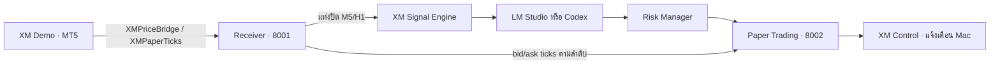

# XAUUSD AI Signal Agent · XM Control

ระบบรับราคาทองจาก **XM Demo ผ่าน MT5 บน Mac** สร้างสัญญาณจากแท่งปิด M5/H1 วิเคราะห์ด้วย **LM Studio หรือ Codex** แล้วตรวจ Risk ก่อนเปิด–ปิดสถานะใน **Paper Trading ของ Python** ดูแลระบบและรับการแจ้งเตือนผ่านแอป **XM Control**

บัญชี Paper เริ่มต้น 10,000 USD ใช้หน่วย `simulated_ounce` แยกจากยอดบัญชี XM Demo และไม่มีการส่งออร์เดอร์ไปโบรกเกอร์



## เริ่มใช้งานประจำวันบน Mac

สำหรับเครื่องที่ตั้งค่า MT5, EA และ Python ไว้แล้ว:

1. เปิด **MT5** และเชื่อมบัญชี Demo บน `XMGlobal-MT5 7` ตรวจว่ามี EA สองตัวบนคนละกราฟ: `XMPriceBridge` และ `XMPaperTicks` โดยใช้ `GoldSymbol=GOLD`
2. เตรียม AI ที่จะใช้: เปิด Server/โหลดโมเดลใน **LM Studio** หรือใช้ **Codex CLI** ที่ล็อกอิน ChatGPT แล้ว
3. เปิด [XM Control.app](<mac/build/XM Control.app>) จาก Finder แล้วกด **เริ่มบริการ** แอปเปิดบริการ Python ที่พอร์ต 8001 และ 8002; หากรันอยู่แล้วจะใช้ตัวเดิม
4. เลือก **LM Studio / Codex · ChatGPT** ในแถบ **ผู้วิเคราะห์ AI** ตัวเลือกถูกบันทึกข้ามการเริ่มใหม่ งานที่เริ่มแล้วใช้ AI เดิมจนจบ ส่วนงานถัดไปใช้ตัวเลือกใหม่
5. ตรวจว่า MT5 รับราคาสด, Paper แสดง **ติดตาม Tick สด** และ AI ที่เลือกพร้อมใช้งาน จากนั้นระบบรอสัญญาณที่เข้าเงื่อนไข

เปิดการแจ้งเตือนจากปุ่มในแอป และอนุญาต **System Settings → Notifications → XM Control** กดทดสอบเพื่อยืนยันการส่งได้

Mac ต้องเปิด MT5 และบริการ Python ต่อเนื่อง ขณะรับการแจ้งเตือนต้องเปิด XM Control ค้างด้วย ปิดหน้าต่างแล้วแอปยังอยู่ในแถบเมนู **◈ XM**; ออกจากแอปจะหยุดการแจ้งเตือน แต่บริการ Python ยังทำงานอยู่ ยังไม่ได้ตั้งให้เปิดอัตโนมัติพร้อมล็อกอิน Mac

### ปุ่มควบคุม

| ปุ่ม | ผล |
| --- | --- |
| เริ่มบริการ | เปิด receiver และ XM/AI/Paper ในเครื่อง ไม่เปิด MT5 หรือ LM Studio แทนผู้ใช้ |
| พักเปิดไม้ใหม่ | ห้ามเปิดสถานะใหม่ แต่ยังรับราคาและติดตาม SL/TP ของสถานะเดิม |
| เปิดรับไม้ใหม่ | ยกเลิกการพัก โดยยังต้องผ่าน AI, Risk และกฎบัญชี |
| ยกเว้น AI | สัญญาณใหม่ไม่เรียก AI และไม่ตรวจโครงสร้างตลาด ใช้ฝั่งของสัญญาณโดยตรง |
| ยกเว้น Risk | ข้ามตัวกรองกลยุทธ์ เพดานขาดทุนรายวัน จำนวนไม้สูงสุด และเพดาน notional ยังคุมความเสี่ยง 0.5% ต่อไม้และตรวจความถูกต้องของข้อมูล |
| หยุดบริการ | พักการเข้าใหม่ก่อน และหยุดได้เมื่อไม่มีสถานะเปิด; หากยังมีไม้เปิดจะคงบริการติดตามไว้ |

ปุ่มยกเว้นทั้งสองปิดไว้เป็นค่าเริ่มต้น ตอนเปิดต้องกดยืนยันสองครั้ง และจดจำค่าข้ามการเริ่มใหม่ ใช้ทดลองใน Paper เท่านั้น รายละเอียดอยู่ใน [RISK.md](RISK.md#โหมดยกเว้น-ai-และ-risk-manager)

หลังหยุดแล้วเริ่มใหม่ สถานะพักยังคงอยู่ ให้กด **เปิดรับไม้ใหม่** เมื่อต้องการรับ entry ต่อ รายละเอียดหน้าจออยู่ใน [MAC-CONTROL.md](MAC-CONTROL.md)

## รันผ่าน Terminal

รันคำสั่งจากโฟลเดอร์ `xauusd-ai-agent` ใช้ Terminal สองหน้าต่าง หรือใช้ปุ่มเริ่มบริการในแอป:

**Terminal 1 — รับข้อมูลจาก MT5**

```sh
sh scripts/run_mt5_bridge.sh
```

**Terminal 2 — สร้างสัญญาณ วิเคราะห์ AI และ Paper Trading**

```sh
sh scripts/run_xm.sh
```

ตรวจข้อมูลและบัญชีจากอีก Terminal โดยสคริปต์อ่าน token ภายในเครื่องให้:

```sh
.venv/bin/python scripts/mt5_status.py GOLD
.venv/bin/python scripts/xm_status.py
.venv/bin/python scripts/paper_status.py --watch
```

เมื่อเปิดผ่านแอป log อยู่ที่ `.runtime/receiver.log` และ `.runtime/xm.log` หากรันใน Terminal จะเห็นผลในหน้าต่างนั้น รวมเหตุการณ์ `PAPER ...` หลังบันทึกบัญชีสำเร็จ

| บริการ | ที่อยู่ในเครื่อง | ฐานข้อมูล |
| --- | --- | --- |
| MT5 receiver: snapshots และ ticks | `127.0.0.1:8001` | `data/mt5-market.db` |
| XM signals, AI, Risk, Paper และ Control API | `127.0.0.1:8002` | `data/xm-trading.db` |
| TradingView/OANDA webhook ทางเลือก | `127.0.0.1:8000` | `data/trading.db` |

ทุกบริการฟังเฉพาะ loopback และใช้ Uvicorn หนึ่ง worker ตรวจ `/health` ได้โดยไม่ใช้ token แต่ผลนี้ยืนยันตัวบริการ/ฐานข้อมูล/worker เท่านั้น **ไม่ได้ยืนยันว่าราคาใหม่หรือ AI เชื่อมต่อได้** ให้ดูหน้าจอและคำสั่งสถานะประกอบ

## ติดตั้งบนเครื่องใหม่

ต้องมี Python 3.11, MT5 สำหรับ Mac และบัญชี XM Demo หากจะ build แอป Mac ต้องมี Xcode Command Line Tools และ macOS 13 ขึ้นไป

```sh
python3.11 -m venv .venv
.venv/bin/python -m pip install -r requirements-lock.txt
.venv/bin/python scripts/init_env.py
.venv/bin/python scripts/init_mt5.py
```

`init_env.py` สร้าง `.env` พร้อม token แยกสำหรับรับ/อ่านสัญญาณ ส่วน `init_mt5.py` สร้าง `.env.mt5` และ `mt5/bridge-token.txt` ทั้งสองสคริปต์ไม่เขียนทับค่าที่มีอยู่ ไฟล์ลับใช้สิทธิ์ 0600 และถูกละเว้นใน Git ดูตัวแปรตัวอย่างใน [.env.example](.env.example)

จากนั้นตั้งค่า MT5 ตาม [MT5.md](MT5.md) และ tick exporter ตาม [PAPER.md](PAPER.md):

1. ใน MT5 เลือก **File → Open Data Folder** คัดลอก source/binary ของ `XMPriceBridge` และ `XMPaperTicks` ไป `MQL5/Experts/` ถ้าคอมไพล์ใหม่ให้ตรวจว่าไม่มี errors
2. คัดลอก `mt5/bridge-token.txt` ไป `MQL5/Files/`
3. ที่ **Tools → Options → Expert Advisors** อนุญาต WebRequest ไป `http://127.0.0.1:8001`
4. แนบ EA ทั้งสองตัวบนคนละกราฟ โดยใช้ server และ symbol ตรงกับบัญชีที่ตั้งค่าไว้ รอประวัติ M5/H1 ครบอย่างละ 300 แท่ง
5. ตั้งค่า AI แล้วปิดตัวแอปก่อน build:

```sh
sh scripts/build_mac.sh
```

เปิด `mac/build/XM Control.app` แล้วทำตามขั้นตอนใช้งานประจำวัน หากย้ายโฟลเดอร์โครงการ ให้ build ใหม่เพื่อบันทึกตำแหน่งที่ถูกต้อง

`requirements-lock.txt` ระบุเวอร์ชันที่ใช้ทดสอบ รวมเครื่องมือทดสอบ ส่วน `requirements.txt` และ `requirements-dev.txt` เป็นขอบเขต dependencies สำหรับการอัปเดต ค่าจาก environment มีลำดับเหนือ `.env` และ path แบบ relative อ้างอิงจากรากโครงการ

## เลือก AI

| ตัวเลือก | การเชื่อมต่อ | การตั้งค่า |
| --- | --- | --- |
| LM Studio | เรียกโมเดลผ่าน Server ที่กำหนด | `LM_STUDIO_URL`, `LM_STUDIO_MODEL`, `AI_REASONING_EFFORT` |
| Codex · ChatGPT | เรียก Codex CLI ด้วยบัญชี ChatGPT ที่ล็อกอินไว้ ใช้อินเทอร์เน็ตและโควตา Codex | `CODEX_MODEL`, `CODEX_CLI_PATH` เมื่อจำเป็น |

ค่าที่ทดสอบในโครงการ: LM Studio ใช้ `qwen/qwen3.8-27b` กับ reasoning `none`; Codex ใช้ `gpt-6-astra` กับ reasoning `low` ตัวเลือก Codex ส่งข้อมูลสัญญาณไปประมวลผลผ่าน OpenAI และเป็นงานแยกจากแชตที่ใช้พัฒนาระบบ

`AI_PROVIDER` ตั้งตัวเลือกครั้งแรกได้ (`lm_studio` เป็นค่าเริ่มต้น) หลังเลือกใน UI แล้วจะใช้ค่าที่บันทึกในฐานข้อมูล ไม่มีการสลับผู้ให้บริการอัตโนมัติ ผลแต่ละงานระบุ `provider` และ `model` ที่ใช้จริง

ผลจากทั้งสองตัวต้องเป็น JSON ตาม schema, คง Entry/SL/TP/RR เดิม, ไม่กลับฝั่ง และต้อง WAIT เมื่อหลักฐานยืนยันไม่ครบ จากนั้นตรวจ Risk และอายุสัญญาณอีกครั้งก่อนอนุญาต entry ค่าเริ่มต้น timeout 90 วินาที และอายุสัญญาณ 300 วินาที หากตอบช้าจนหมดอายุจะไม่ยืนยันสัญญาณนั้น

ดู [AI.md](AI.md) สำหรับ LM Studio และ [CODEX.md](CODEX.md) สำหรับการล็อกอิน การแยกโปรเซส และข้อจำกัด Codex

## สัญญาณและบัญชี Paper

XM Signal Engine รุ่น `xm-0.1` ใช้แท่งปิด M5 ร่วมกับแนวโน้ม H1 และหลักฐาน pivot/market structure ไม่สร้าง candidate เมื่อข้อมูลหรือเงื่อนไขไม่ครบ เก็บ checkpoint, สัญญาณ, คิว AI และหลักฐานต้นทางลงฐานข้อมูลเพื่อป้องกันการส่งซ้ำหลังรีสตาร์ต รายละเอียดกฎและเวลา broker อยู่ใน [XM-SIGNALS.md](XM-SIGNALS.md)

บัญชี Paper ใช้ **bid/ask ticks ตามลำดับ** จาก `XMPaperTicks` สำหรับราคาเข้า การประเมินมูลค่า และ SL/TP บันทึก positions, decisions, ledger และ cursor แบบ transaction คำนวณเงินด้วย Decimal

| กฎเริ่มต้น | ค่า |
| --- | --- |
| ทุนตั้งต้น | 10,000 USD |
| สถานะเปิดสูงสุด | 1 |
| ความเสี่ยงต่อไม้/รวมสถานะเปิด | ไม่เกิน 0.5% ตามกฎบัญชี |
| เพดานขาดทุนรายวัน | 2% รวม unrealized P/L และค่าธรรมเนียม |
| อายุ quote สำหรับเปิดไม้ใหม่ | ไม่เกิน 30 วินาที และ tick stream ต้องตามทัน |

Paper รวม spread ผ่าน bid/ask, slippage และ commission ตาม policy จำลอง ยังไม่จำลอง lot/contract specification จริง, margin, swap/financing หรือ partial fill รายละเอียดอยู่ใน [PAPER.md](PAPER.md) และ [RISK.md](RISK.md)

## API สำหรับระบบ XM

บนพอร์ต **8002** ใช้ Bearer `API_TOKEN` สำหรับทุก endpoint ด้านล่าง ยกเว้น `/health`:

| Method / Path | หน้าที่ |
| --- | --- |
| GET `/health` | ตรวจบริการ/ฐานข้อมูล/AI worker |
| GET `/xm/status` | สถานะ signal engine และ Paper worker |
| GET `/dashboard/state` | สถานะรวม ตัวเลือก AI บัญชี และเหตุการณ์ |
| POST `/dashboard/ai-provider` | เลือก AI ด้วย `{"provider":"lm_studio"}` หรือ `{"provider":"codex"}` |
| POST `/dashboard/bypass` | เปิด/ปิดโหมดยกเว้นด้วย `{"ai":true}`, `{"risk":false}` หรือทั้งสองค่า |
| POST `/dashboard/pause` | พัก/รับ entry ด้วย `{"paused":true}` หรือ `{"paused":false}` |
| GET `/signals` และ `/signals/<id>` | อ่านสัญญาณที่บันทึก |
| GET `/signals/<id>/analysis` | ผล AI, ผู้วิเคราะห์, Risk status และ `effective_decision` |
| GET `/signals/<id>/risk` | รายงาน Risk, การคำนวณ และ policy snapshot |
| GET `/paper/account` | Balance, Equity, P/L, สถานะราคา และกฎบัญชี |
| GET `/paper/positions?status=open` หรือ `closed` | สถานะเปิดหรือประวัติที่ปิดแล้ว |
| GET `/paper/ledger` และ `/paper/decisions` | รายการบัญชีและผลพิจารณา entry |

Lists ของสัญญาณและบัญชีใช้ pagination ตาม id และจำกัดสูงสุด 100 รายการต่อคำขอ อ่านผลยืนยันจาก `effective_decision` เพราะคำตอบ BUY/SELL ของ AI เพียงอย่างเดียวยังไม่ยืนยันว่าเปิดสถานะได้

บนพอร์ต **8001** ใช้ Bearer `MT5_BRIDGE_TOKEN` จาก `.env.mt5`: `POST /mt5/snapshot`, `POST /mt5/ticks`, `GET /mt5/latest?symbol=GOLD`, `GET /mt5/ticks/cursor?symbol=GOLD` และ `GET /mt5/status` ส่วน `/health` ไม่ต้องใช้ token งบรับ snapshot คือ 20 คำขอ/นาที และ Tick 64 คำขอ/นาที แยกจากกัน

## ข้อมูลที่เก็บและความลับ

| ตำแหน่ง | เนื้อหา |
| --- | --- |
| `data/mt5-market.db` | Market snapshots, ordered ticks และ coverage/cursor |
| `data/xm-trading.db` | XM signals, ผล AI/Risk, บัญชี Paper, ตัวเลือก AI และเหตุการณ์ UI |
| `data/trading.db` | สัญญาณจากเส้นทาง TradingView/OANDA ทางเลือก |
| `.runtime/` | Log ของบริการที่เริ่มผ่านแอป, รายงานตรวจ และฐานข้อมูลสำรองที่ทำไว้ |
| `config/` | Risk policy และกฎบัญชี Paper |

`.env`, `.env.mt5`, ไฟล์ token, ฐานข้อมูล และ `.runtime/` ถูกละเว้นใน Git อย่าใส่ token ใน source, URL ที่แชร์, ภาพหน้าจอ หรือ log แอป Mac เก็บ bearer token ในฝั่ง native; หน้า UI ไม่มี token และโปรเซส Codex ไม่ได้รับ trading tokens หรือ Platform API keys

สำรอง SQLite ด้วย backup API ขณะบริการทำงาน หรือหยุดบริการอย่างถูกต้องก่อนสำรอง เก็บฐานข้อมูลเดิมก่อนแก้ policy หรือสอบสวนปัญหาประวัติราคา

## แก้ปัญหาเบื้องต้น

| อาการ | ตรวจและดำเนินการ |
| --- | --- |
| ไม่พบข้อมูล MT5 | ตรวจ XM connection, server/symbol, EA, token ใน `MQL5/Files` และ WebRequest allowlist |
| กำลังรับ Tick ย้อนหลัง | EA ยังส่งข้อมูลค้างอยู่ เปิด Mac/MT5 ต่อจนตามทัน; v1.02 ส่งได้สูงสุด 8 หน้า/รอบ โดยไม่ข้ามประวัติ |
| ไม่มี Tick สด / `feed_stale` | ดู `XMPaperTicks` และ Experts log; snapshot จาก XMPriceBridge ที่สดไม่ได้แปลว่า tick stream สดด้วย |
| `tick_history_gap_review_required` หรือ engine ขอ reset | ตรวจประวัติ/coverage และ checkpoint ก่อนดำเนินการ ไม่ล้างฐานข้อมูลเพื่อข้ามข้อผิดพลาด |
| LM Studio ยังไม่พร้อม | ตรวจ URL, Server และโมเดลที่โหลด หรือเลือก Codex จากแอป |
| Codex ยังไม่พร้อม/ถึงโควตา | ตรวจ `codex login status`, โมเดลและโควตาบัญชี หรือเลือก LM Studio |
| ยังไม่เปิดไม้ทั้งที่มีผล AI | ตรวจ `effective_decision`, อายุสัญญาณ, ความสด Tick, สถานะพัก, policy และเพดานรายวัน |
| ไม่เห็นแจ้งเตือน Mac | ตรวจ Allow Notifications, Focus และให้แอปยังเปิดอยู่ |

หลังเปลี่ยนไฟล์ EA ให้นำตัวเดิมออกจากกราฟ → Navigator → Refresh → แนบใหม่ เพื่อโหลดโค้ดใหม่ ผลวิเคราะห์ล่าสุดในแอปเป็นประวัติของงานนั้น ให้ดูชื่อ AI/วันที่ควบคู่กับการ์ดสถานะปัจจุบัน

## การทดสอบและผลตรวจล่าสุด

ทดสอบอัตโนมัติด้วยข้อมูลจำลองและฐานข้อมูลชั่วคราว:

```sh
.venv/bin/python -m pytest -q
.venv/bin/python scripts/smoke_test.py
.venv/bin/python scripts/smoke_mt5.py
```

ทดสอบ AI จริงโดยสมัครใจ ใช้ข้อมูลสมมติและฐานข้อมูลแยกจากบัญชีใช้งาน คำสั่ง Codex ใช้โควตาบัญชี:

```sh
.venv/bin/python scripts/test_lm_studio.py --xm --provider lm_studio
.venv/bin/python scripts/test_lm_studio.py --xm --provider codex
```

ผลตรวจที่บันทึกถึง **4 พฤศจิกายน 2026**:

- ชุดทดสอบ Python: **231 passed**, 1 Starlette/httpx deprecation warning
- LM Studio จริง: **10.8 วินาที**, AI=WAIT, risk=passed บนข้อมูล XM สมมติ [ผลตรวจ](tests/lmstudio-xm-live-2026-11-03.json)
- Codex จริง: **11.3 วินาที**, AI=BUY, risk=passed บนข้อมูล XM สมมติ [ผลตรวจ](tests/codex-xm-live-2026-11-04.json)
- ตรวจ UI Mac, การสลับ AI, persistence และการป้องกันผลผิดรูปแบบ/หมดเวลาแล้ว [รายงาน Codex](tests/codex-provider-verification-2026-11-04.md)
- ทดสอบกู้ Tick หลังหลุดข้ามคืนจนกลับมา `running`/ราคาสด โดยไม่ข้าม coverage [รายงาน Tick recovery](tests/tick-recovery-verification-2026-11-04.md)

ผลเหล่านี้ยืนยันการเชื่อมต่อและพฤติกรรมที่ทดสอบ ยังไม่มีผลประเมินกำไร/Win Rate ของระบบ XM หลัง AI กรองบนข้อมูลระยะยาว

## TradingView/OANDA ทางเลือก

โค้ด Pine และ webhook เดิมยังอยู่ในโครงการ ดู [pine/README.md](pine/README.md) รันด้วย:

```sh
sh scripts/run_local.sh
```

บริการนี้อยู่พอร์ต **8000** แยกฐานข้อมูลจาก XM รับ `POST /webhook` ด้วย Bearer `WEBHOOK_TOKEN` หรือ `POST /webhook/tradingview/<WEBHOOK_TOKEN>` สำหรับ TradingView ส่วนการอ่านสัญญาณใช้ `API_TOKEN` คนละชุด

รับ JSON UTF-8 แบบ strict, จำกัด body เริ่มต้น 16 KiB, ตรวจ schema/ราคา/เวลา และใช้ signal ID ป้องกันรายการซ้ำ `201` หมายถึงบันทึกใหม่, `200` หมายถึงข้อมูลเดิม, `409` หมายถึง ID เดิมแต่ payload ต่างกัน สัญญาณที่เก่าเกินเกณฑ์ถูกปฏิเสธก่อน deduplication

เส้นทาง XM ใช้งานได้โดยไม่ต้องมี TradingView Alert หรือ Cloudflare Tunnel ปัจจุบันยังไม่มี Tunnel/Alert จริงหรือ Telegram ที่เชื่อมใช้งานในโครงการ หากนำ webhook ออกสู่ภายนอกต้องเก็บ URL ที่มี token เป็นความลับและปกปิด path ใน proxy log ด้วย

## คู่มือเพิ่มเติม

| คู่มือ | เนื้อหา |
| --- | --- |
| [MAC-CONTROL.md](MAC-CONTROL.md) | หน้าจอ ปุ่มควบคุม การแจ้งเตือน และ build แอป Mac |
| [MT5.md](MT5.md) | ติดตั้ง XMPriceBridge, WebRequest และตรวจ snapshots |
| [XM-SIGNALS.md](XM-SIGNALS.md) | กฎสัญญาณ XM, checkpoint, หลักฐานต้นทาง และเวลา broker |
| [AI.md](AI.md) | การตั้งค่าและตรวจ LM Studio |
| [CODEX.md](CODEX.md) | การเลือก Codex, auth, โควตา และการทดสอบ |
| [RISK.md](RISK.md) | Risk Manager ต่อสัญญาณ |
| [PAPER.md](PAPER.md) | XMPaperTicks, ledger, P/L, SL/TP และกฎระดับบัญชี |
