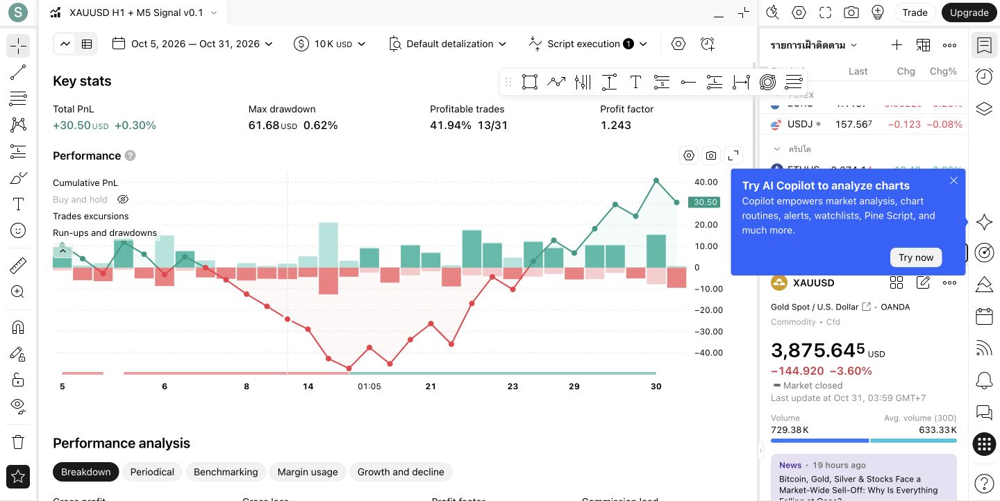

# ผลตรวจ Pine และ Backtest เบื้องต้น

ตรวจเมื่อ 1 พฤศจิกายน 2026 (Asia/Bangkok) ผ่าน TradingView บน Chrome

- สคริปต์: XAUUSD H1 + M5 Signal v0.1 บันทึกเป็นสคริปต์ส่วนตัวแล้ว
- คอมไพล์ผ่าน เพิ่มลงกราฟได้ และรายงานกลยุทธ์แสดงผลสำเร็จ
- ข้อมูล: OANDA:XAUUSD, 5 นาที, Candles
- ช่วงที่รายงานแสดง: 5–31 ตุลาคม 2026
- Inputs ใช้ค่าเริ่มต้นตามซอร์ส ไม่มีการปรับเพื่อเพิ่มผลกำไร

| ตัวชี้วัด | ผลจาก TradingView |
| --- | --- |
| Total PnL | +30.50 USD (+0.30%) |
| Max drawdown | 61.68 USD (0.62%) |
| จำนวนเทรด | 31 |
| ชนะ | 13 (41.94%) |
| แพ้ | 18 (58.06%) |
| Profit factor | 1.243 |
| Gross profit | 156.13 USD |
| Gross loss | 125.63 USD |
| Expectancy | 0.98 USD |
| Short PnL | +42.20 USD |
| Long PnL | −11.71 USD |

ค่าที่ปัดใน UI อาจรวมกันคลาดเคลื่อน 0.01 USD

## Properties ที่ตรวจจาก UI

- Initial capital: 10,000 USD
- Default order size: 1 Quantity
- Pyramiding: 0
- Bar detalization: Default (4 ticks per bar)
- Script execution: On bar close
- Commission: 0.01 Percent
- Long/short leverage: 1x
- Slippage: 2 ticks
- Limit order execution: Requested price
- Order execution delay: None

## ข้อจำกัดและงานที่ยังไม่ได้ทดสอบ

ผลนี้เป็นการตรวจการทำงานเบื้องต้นของ Pine baseline ไม่มี AI คัดกรอง มีเพียง 31 เทรด และยังไม่ได้แยก out-of-sample ค่า commission/slippage ยังเป็น placeholder ไม่ใช่ต้นทุนที่ผู้ใช้ยืนยัน และยังไม่มี spread แยกต่างหาก จึงยังไม่ใช้ยืนยันประสิทธิภาพสำหรับเงินจริง

ยังไม่ได้ตรวจ realtime Alert JSON, replay/reload consistency หรือเปรียบเทียบ H1 ทีละแท่ง และยังไม่ได้ใช้ Bar Magnifier

บัญชี Basic แสดงข้อจำกัด 1 saved layout จึงบันทึก Layout ใหม่ไม่สำเร็จ ไม่ได้อัปเกรดหรือเขียนทับ Layout เดิม เก็บแท็บกราฟไว้ให้ใช้งานต่อ สคริปต์บันทึกแยกจาก Layout แล้ว

