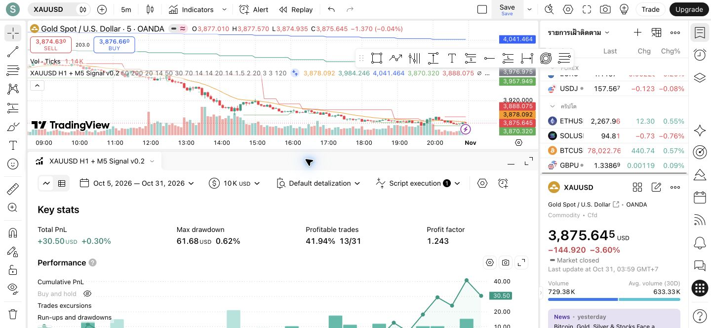

# Market Structure และแนวรับ–แนวต้าน v0.2

เพิ่ม context สำหรับ AI โดยคง candidate BUY/SELL, Entry/SL/TP และคำสั่งจำลองเดิม เพื่อให้เปรียบเทียบ baseline และ AI บนชุดสัญญาณเดียวกันได้ ไม่ได้เพิ่ม pivot filter ลงใน strategy.entry ดังนั้น Strategy Tester ยังเป็นผล baseline ไม่ใช่ผลหลัง AI กรอง

## กฎที่ใช้

- วิเคราะห์ pivot บน M5 โดยใช้ `ta.pivothigh/ta.pivotlow` ซ้าย 3 ขวา 3 แท่ง ปรับได้ 1–20
- Pivot จะใช้งานได้เมื่อแท่งขวาสุดปิดแล้วเท่านั้น เช่น right=3 ต้องรอ 3 แท่ง M5 หลังแท่ง pivot
- เก็บทั้งเวลาปิดแท่ง pivot และเวลาที่ทราบผลยืนยันจริง ไม่ย้ายสัญญาณหรือเส้นกลับไปในอดีต
- เก็บ high 2 จุดล่าสุดและ low 2 จุดล่าสุดอย่างอิสระ ไม่อ้างว่าเป็น ZigZag, BOS หรือ CHoCH
- Bullish: high ล่าสุด > high ก่อนหน้า และ low ล่าสุด > low ก่อนหน้า
- Bearish: high ล่าสุด < high ก่อนหน้า และ low ล่าสุด < low ก่อนหน้า
- กรณีอื่นเป็น ranging รวมถึงราคาพิกัดเท่ากัน; หากขาดจุดหรือจุดใดเก่าเกินเกณฑ์เป็น insufficient
- อายุเริ่มต้นสูงสุด 120 แท่งนับจากแท่งยืนยัน (10 ชั่วโมงของแท่ง M5 ไม่ใช่เวลาปฏิทิน) ปรับได้ 1–288
- แนวรับคือ low ล่าสุด และแนวต้านคือ high ล่าสุดที่ยืนยันแล้ว ยัง active และไม่หมดอายุ
- แนวรับหมดสถานะ active เมื่อราคาปิดต่ำกว่า level แนวต้านหมดสถานะเมื่อราคาปิดสูงกว่า level สถานะไม่คืนเองแม้ราคาย้อนกลับ ต้องรอ pivot ใหม่
- การทะลุด้วย wick อย่างเดียวไม่ทำให้ inactive ตามกฎเริ่มต้นนี้ และไม่เปลี่ยนบทบาทแนวรับเป็นแนวต้านอัตโนมัติ

การยืนยัน pivot เป็นหลักฐานจากแท่งราคา ไม่ได้รับรองว่าระดับจะรับ/ต้านราคาได้ในอนาคต การใช้ pivot ที่ยืนยันช้ามีความล่าช้าตามจำนวน right bars ตาม [คำอธิบาย TradingView เรื่อง pivot/repainting](https://www.tradingview.com/pine-script-docs/concepts/repainting/)

## Payload และความเข้ากันได้

v0.2 ใช้ schema_version=2, strategy_version="0.2" และต่อท้าย signal_id ด้วย `:0.2` ตัวอย่างอยู่ที่ `examples/signal-v2.json` ส่วน v0.1 เก็บสำรองใน `pine/xauusd_strategy_v0.1.pine`

`context.market_structure` มี timeframe, method, left_bars, right_bars, max_age_bars, state และ recent_high/previous_high/recent_low/previous_low แต่ละจุดมี price, pivot_close_ms, confirmed_at_ms, age_bars และ active ก่อนมีจุดครบจะใช้ null ตามจริง

FastAPI รองรับทั้ง schema v1 และ v2 โดยบังคับจับคู่เวอร์ชันกับรูปแบบ payload และ ID ที่ถูกต้อง Python ตรวจ state ซ้ำจากราคา ตรวจลำดับ pivot/เวลายืนยัน/อายุ และไม่รับ active level ที่ถูกราคาปัจจุบันทะลุแล้ว อย่างไรก็ตาม receiver ไม่มี OHLC history ครบเพื่อคำนวณ pivot ซ้ำเอง จึงยังอาศัยแหล่ง Pine ที่ผ่าน authentication เป็นผู้ส่งหลักฐาน

## เงื่อนไขก่อน AI ยืนยัน

`app/structure.py` คำนวณ blocker และ `app/ai_analyzer.py` ตรวจซ้ำหลังโมเดลตอบ:

1. มีครบสี่จุดและไม่หมดอายุ โครงสร้างตรงกับฝั่งสัญญาณ
2. แนวรับ/แนวต้านล่าสุด active และ Entry อยู่ระหว่างสองระดับอย่างเคร่งครัด
3. BUY: SL ต่ำกว่าแนวรับ และ TP ไม่เกินแนวต้าน
4. SELL: SL สูงกว่าแนวต้าน และ TP ไม่ต่ำกว่าแนวรับ
5. ถ้าไม่ผ่านข้อใด AI ต้อง WAIT; ถ้าผ่านครบ AI ยังเลือก WAIT ได้

ระบบไม่แก้ราคา ATR SL/TP ให้ผ่านกฎ หากระดับไม่สอดคล้องจะรอแทน กฎนี้เป็น structural evidence gate ส่วนการตรวจความเสี่ยงต่อสัญญาณและ position sizing จำลองเพิ่มใน [Risk Manager](../RISK.md) ภายหลัง โดยยังไม่มี daily-loss limit ที่ผูกกับบัญชีรายการจริง

## การตรวจในรอบนี้

- คอมไพล์ v0.2 ใน TradingView ผ่าน ไม่มี runtime error บน OANDA:XAUUSD M5
- แสดงเส้น Confirmed pivot support/resistance ได้
- บันทึกอัปเดตสคริปต์เดิมเป็นชื่อ `XAUUSD H1 + M5 Signal v0.2` เนื่องจากบัญชีจำกัด 1 saved script รุ่นเดิมยังมีในไฟล์สำรองและ TradingView version history
- นำสำเนาชั่วคราวออกแล้ว เหลือกลยุทธ์ v0.2 หนึ่งรายการบนกราฟ
- Baseline ที่แสดงยังเท่าเดิม: 31 trades, 41.94% profitable, PF 1.243, PnL +30.50 USD ช่วง 5–31 ตุลาคม 2026 เพราะยังไม่ได้เปลี่ยนกฎ entry/exit
- ยังไม่ได้ตรวจ realtime alert delivery, replay/reload consistency หรือวัด Win Rate หลัง AI กรอง
- เมื่อสร้าง Alert ในขั้น Tunnel ต้องใช้ v0.2; Alert เก่าจะไม่อัปเดตตามสคริปต์อัตโนมัติ

